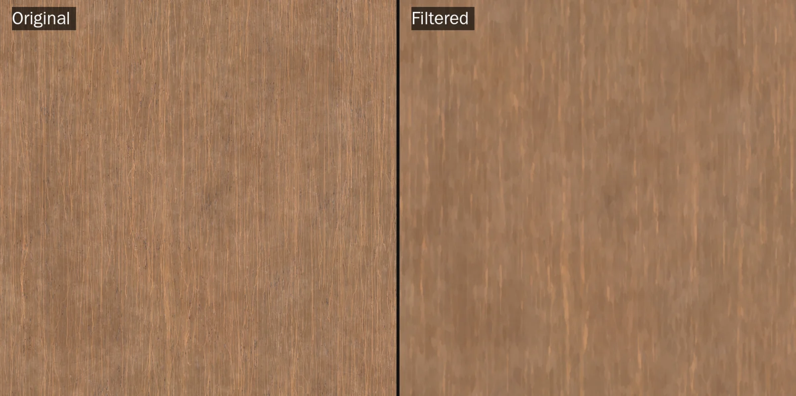
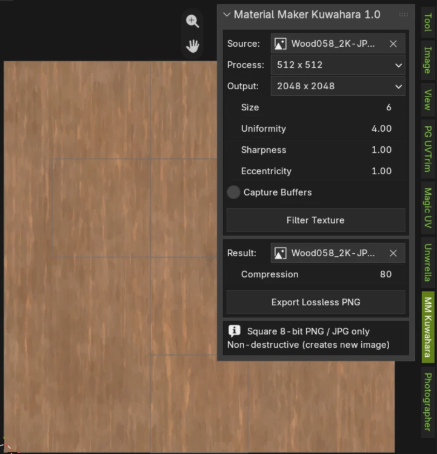
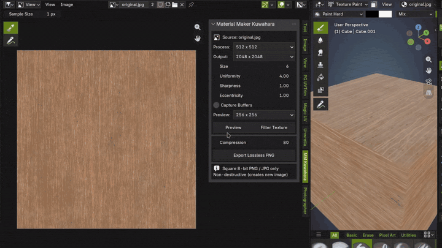

# Material Maker Kuwahara Texture

Apply Material Maker's **anisotropic Kuwahara** filter to image textures inside Blender. The filter turns a photo-like texture into a smooth, painterly one: flat colour areas with brushstroke-like detail that follows the direction of the structure in the image.

The filter runs on the GPU and is a port of the Material Maker node. It aims to give the same result as Material Maker, including how Godot converts 8-bit images, so you can use it as a stand-in when you don't want to leave Blender.

> **Blender 5.2 or newer.** Experimental. Works on single, square 8-bit images (JPEG or PNG).



---

## Contents

- [Installation](#installation)
- [Usage](#usage)
- [Preview](#preview)
- [Settings](#settings)
- [Input requirements](#input-requirements)
- [Exporting the result](#exporting-the-result)
- [Diagnostic buffers](#diagnostic-buffers)
- [How it works](#how-it-works)
- [Folder structure](#folder-structure)
- [Development](#development)
- [Licence and credits](#licence-and-credits)

---

## Installation

1. Download `mm_kuwahara_texture-x.y.z.zip` from the [Releases](../../releases) page.
2. In Blender open **Edit → Preferences → Add-ons**.
3. Open the drop-down in the top right, choose **Install from Disk…** and pick the zip.
4. Enable **Material Maker Kuwahara Texture**.

---

## Usage

1. Open the **Image Editor** and load a square JPEG or PNG texture.
2. Open the sidebar (`N`) and go to the **MM Kuwahara** tab.
3. Choose the image under **Source**, or leave it empty to use the image shown in the editor.
4. Adjust the settings. Click **Preview** to check them quickly (see [Preview](#preview)), then click **Filter Texture** for the full result.
5. A new image named `<source name>_MM_Kuwahara` is created and shown in the editor. Your original image is not changed.
6. Click **Export Lossless PNG** to save it.





The new image is packed into the .blend file and has a fake user, so it is not lost when you close Blender.

---

## Settings

| Setting | Range | Default | What it does |
|---------|-------|---------|--------------|
| **Process** | 128 to 4096 | 512 | Resolution the filter runs at. Higher is slower and needs more GPU memory |
| **Output** | Same as processing, or 128 to 8192 | 2048 | Resamples the finished result to this size. It does not change the brushstroke size |
| **Size** | 1 to 32 | 6 | Size of the filter. Larger values give bigger brushstrokes |
| **Uniformity** | 0 to 50 | 4 | How much the direction of the structure is smoothed. Higher values make strokes follow larger shapes |
| **Sharpness** | 0 to 1 | 1 | How sharp the edges between regions are |
| **Eccentricity** | 0 to 2 | 1 | How stretched the strokes are along their direction. Material Maker halves this value internally, and so does this add-on |
| **Capture Buffers** | on or off | off | Keeps the intermediate results in memory for debugging. See [Diagnostic buffers](#diagnostic-buffers) |
| **Preview** | 128, 256 or 512 | 256 | Size of the area that **Preview** filters. See [Preview](#preview) |

The brushstroke size depends on **Process**. A 512 pixel pass looks coarser than a 2048 pixel pass of the same image, because the filter works in pixels. Use **Output** to scale the result up or down afterwards.

---

## Preview

**Preview** filters only the middle of the image and shows the result in a temporary image named `<source name>_MM_Preview`. It is a quick way to try Size, Uniformity, Sharpness and Eccentricity on big images without waiting for the whole filter.

- The preview is taken at the **Process** resolution, so the strokes look exactly like they will in the full result. It does not resample to **Output**.
- It is a crop, not a smaller copy of the whole image. At 4096 it filters about 2% of the image, and the pixels are identical to the same pixels of the full result.
- If the image is small (the Process resolution is not much larger than the preview), the whole image is filtered.
- The preview image is not saved with the .blend file, and it cannot be used as a source. Your source stays selected in the panel.
- It uses the same GPU memory as a full run at that resolution, so it is fast but not free at 4096.

[image of the Preview button and a preview in the Image Editor]

---

## Input requirements

The source image must be:

- **Square**: the same width and height.
- **8 bits per channel**: ordinary JPEG and PNG files. Float images such as EXR and HDR are not supported yet.
- **A single still image**: not tiled, a movie or a sequence.
- **Using straight alpha**: premultiplied alpha is refused.
- **Colour space sRGB, Non-Color or Raw**: the filter does not convert colours, so the output keeps the same encoding as the input.

If the image does not meet these, the add-on tells you which rule failed in Blender's status bar.

The output is always **opaque**, like Material Maker's graph. Transparency in the input is not kept.

---

## Exporting the result

**Export Lossless PNG** writes the filtered image as an 8-bit RGBA PNG:

- The pixel values are exactly the ones in the Blender image, with no extra colour conversion.
- **Compression** (0 to 100, default 80) only changes file size and saving time, never the pixels.
- The PNG is tagged as sRGB when the image uses the sRGB colour space.

The button is greyed out until a filtered image exists.

---

## Diagnostic buffers

Turn on **Capture Buffers** before filtering to keep every stage in memory:

- the source,
- the structure tensor,
- the horizontal blur,
- the vertical blur,
- the final filtered result.

They are stored as raw floating-point numbers. **Save diagnostic buffers** (shown while Capture Buffers is on) writes them into one `.npz` file, together with the settings and Blender version. This is meant for comparing the result against Material Maker.

It is off by default because it uses a lot of memory: at 4096 × 4096 it is more than 1 GB of RAM, and it stays in memory until the next run.

---

## How it works

The filter has four GPU passes, plus an optional resampling pass:

1. **Tensor**: measures the direction of the structure in the image.
2. **Blur X** and 3. **Blur Y**: smooth that direction field (this is what **Uniformity** controls).
4. **Filter**: the anisotropic Kuwahara itself, using the smoothed directions.
5. **Export** (only when **Output** differs from **Process**): resamples the result.

To match Material Maker the add-on reproduces its quirks on purpose: pixels are processed top row first, 8-bit input is converted the way Godot does it, intermediate results are 16-bit float, and the final 8-bit conversion truncates instead of rounding. The shader code is kept as it is in the original.

---

## Folder structure

```text
mm_kuwahara_texture/        the add-on (this is what ends up in the zip)
├── __init__.py             operators, panel and GPU passes
├── LICENSES.txt            licences and sources of the original work
└── shaders/                the filter code, kept as in Material Maker
    ├── tensor.glsl         structure tensor
    ├── blur.glsl           Gaussian blur of the tensor
    ├── kuwahara.glsl       the anisotropic Kuwahara filter
    └── sampling.glsl       texture reading helpers
```

---

## Development

The repository root also holds the build and test tooling taken from the shared [blender-addon-kit](https://github.com/ziazarenda/blender-addon-kit):

```text
build.py        runs the tests, builds the zip, installs it into a temporary
                Blender profile and runs the Blender tests
tests/plain/    image_logic.py and shader_text.py, run without Blender
tests/blender/  filter.py, runs the filter inside Blender
.kit.json       records which files come from the kit
```

```bash
uv run python build.py     # tests + build, result in dist/
```

`shader_text.py` stores a checksum of each shader file. If you change a shader on purpose, update the checksums in that test.

---

## Licence and credits

This add-on is released under the **MIT licence** (see `LICENSE`). It is a port of work by others, whose notices are kept in `mm_kuwahara_texture/LICENSES.txt`:

- **Material Maker**, anisotropic Kuwahara and Gaussian blur graphs: Copyright (c) 2018-present Rodolphe Suescun and contributors, MIT. [github.com/RodZill4/material-maker](https://github.com/RodZill4/material-maker)
- **Anisotropic Kuwahara filter**: Copyright (c) 2022 Garrett Gunnell, MIT. [github.com/GarrettGunnell/Post-Processing](https://github.com/GarrettGunnell/Post-Processing)

This project is not affiliated with or endorsed by either of them.
